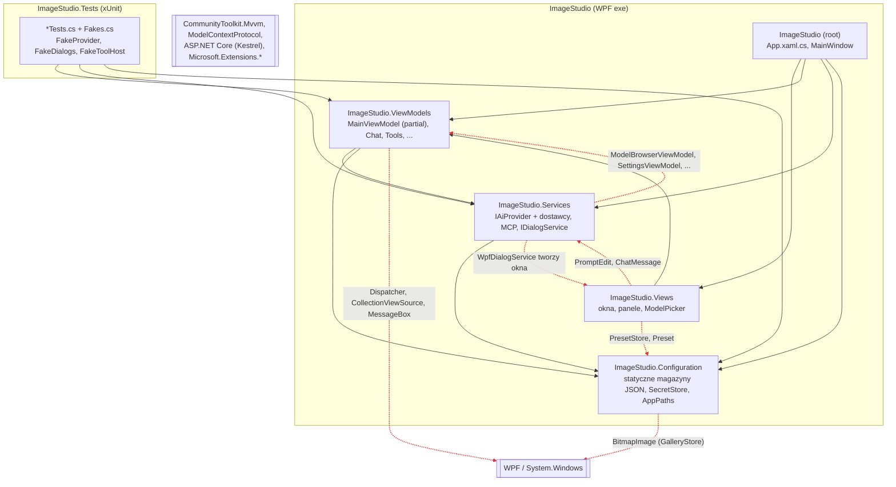
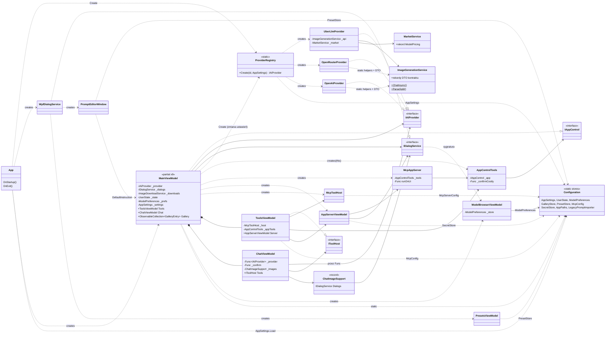
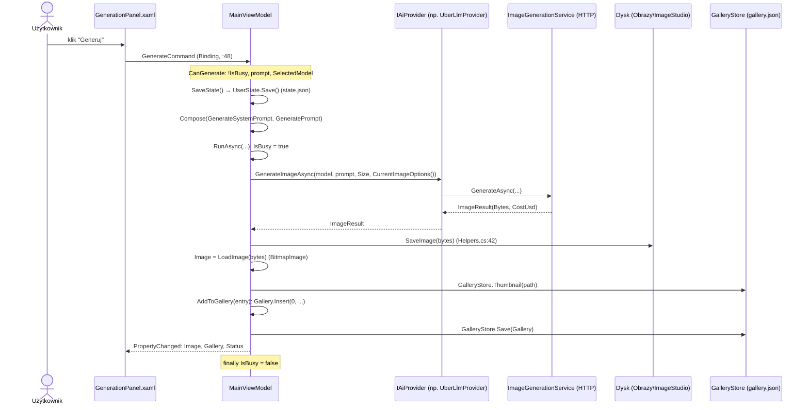

# Architektura ImageStudio

Opis stanu kodu z gałęzi `feature/imagestudio-ai-providers` (listopad 2026). Wszystkie zależności i numery linii
zostały sprawdzone w kodzie (`using`, parametry konstruktorów, pola, wywołania statyczne), a nie wzięte z opisu.

Jedna aplikacja `ImageStudio` (WPF, `net10.0-windows`) i jeden projekt testów `ImageStudio.Tests`. Warstwy to
przestrzenie nazw w jednym assembly, więc kompilator nie pilnuje kierunku zależności i pilnuje go tylko dyscyplina.

## 1. Warstwy i zależności projektów

Strzałka oznacza „zależy od”. Krawędzie czerwone łamią kierunek do środka (szczegóły w sekcji 4).

Pakiety: `CommunityToolkit.Mvvm`, `ModelContextProtocol`, `ModelContextProtocol.AspNetCore`
(`ImageStudio/ImageStudio.csproj:28-30`) oraz `FrameworkReference Microsoft.AspNetCore.App` (`:13`) dla serwera MCP.
Testy mają tylko `ProjectReference` do `ImageStudio` (`ImageStudio.Tests/ImageStudio.Tests.csproj:14`).

## 2. Kluczowe klasy i ich zależności

Typ pola i parametru konstruktora w nawiasach. „creates” oznacza `new` wewnątrz klasy, „static” to wywołanie statycznej klasy.

Źródła krawędzi:

| Krawędź | Dowód |
|---|---|
| App tworzy wszystko | `App.xaml.cs:23-29` |
| MainViewModel: konstruktor, pola | `ViewModels/MainViewModel.cs:33-39`, `:102-103` |
| MainViewModel składa Tools/Chat/MCP | `ViewModels/MainViewModel.cs:120-129` |
| MainViewModel wymienia dostawcę | `ViewModels/MainViewModel.Settings.cs:53-54` |
| MainViewModel : IAppControl | `ViewModels/MainViewModel.AppControl.cs:9` |
| ChatViewModel: konstruktor | `ViewModels/ChatViewModel.cs:13`, `:29-32` |
| ToolsViewModel: konstruktor (konkretne `McpToolHost`, `AppControlTools`) | `ViewModels/ToolsViewModel.cs:51`, `:62-64` |
| AppControlTools → IAppControl | `Services/AppControlTools.cs:26`, `:30` |
| McpAppServer → AppControlTools | `Services/McpAppServer.cs:19`, `:24` |
| UberLlmProvider → ImageGenerationService, MarketService | `Services/UberLlmProvider.cs:8-15` |
| OpenRouter/OpenAI używają statycznych metod `ImageGenerationService` | `Services/OpenRouterProvider.cs:206,217,231`, `Services/OpenAiProvider.cs:115,126,140` |
| ProviderRegistry tworzy dostawców | `Services/ProviderRegistry.cs:17-23` |
| WpfDialogService tworzy okna i ViewModele | `Services/WpfDialogService.cs:43-44,66-67,76,89,93-94` |
| ModelBrowserViewModel → ModelPreferences | `ViewModels/ModelBrowserViewModel.cs:38-41` |

## 3. Przepływ: „Generuj” → obraz w galerii

Kod: `Views/GenerationPanel.xaml:48` → `ViewModels/MainViewModel.Generation.cs:137-144` (`GenerateAsync`) →
`:218-254` (`RunAsync`) → `ViewModels/MainViewModel.Helpers.cs:42-62` (`SaveImage`, `LoadImage`) →
`ViewModels/MainViewModel.Gallery.cs:53-58` (`AddToGallery`) → `Configuration/GalleryStore.cs`.
Ta sama ścieżka obsługuje narzędzie `generate` z czatu i z serwera MCP przez `IAppControl.GenerateAsync`.

## 4. Naruszenia czystej architektury

Każdy punkt sprawdzony grepem. Waga: **W** wysoka (cykl albo brak testowalności), **Ś** średnia, **N** niska (kosmetyka).

### 4.1 Cykle między przestrzeniami nazw

- **W. Services ↔ ViewModels.** ViewModels zależą od Services wszędzie, a Services wracają do ViewModels:
  - `Services/IDialogService.cs:3` (`using ImageStudio.ViewModels`), `:42` `void ShowModelBrowser(ModelBrowserViewModel viewModel)`; interfejs „usług” ma w sygnaturze konkretny ViewModel.
  - `Services/WpfDialogService.cs:5`, `:43` `new SettingsViewModel`, `:66` `new PresetSaveViewModel`, `:93` `new PresetsViewModel`.
- **W. Services ↔ Views.** `Services/WpfDialogService.cs:6` (`using ImageStudio.Views`) tworzy okna (`:44`, `:67`, `:76`, `:89`, `:94`),
  a Views używają typów z Services: `Views/PromptEditorWindow.xaml.cs:6,13,19` (`PromptEdit`), `Views/ChatConversation.xaml:4,8`
  (`DataType="{x:Type svc:ChatMessage}"`). `WpfDialogService` to kod UI, który leży w złej przestrzeni nazw.

### 4.2 Views sięgają do Configuration i do MainViewModel

- **W.** `Views/PromptEditorWindow.xaml.cs:5,28` `PresetStore.LoadAll()`, `:99,113` `Preset`, `:122` `PresetStore.Save(preset)`.
  Okno samo czyta i zapisuje zestawy na dysku, a logika (potwierdzenia, nadpisywanie pól zestawu, `:97-129`) jest w code-behind,
  którego testy nie pokrywają (tak mówi też `CLAUDE.md`).
- **Ś.** `Views/PromptEditorWindow.xaml.cs:87` `MainViewModel.DefaultInstruction`: widok zna stałą konkretnego ViewModelu.
- **N.** `Views/PromptEditorWindow.xaml.cs:103,114,127,131-132` `MessageBox` w code-behind (w widoku to akceptowalne, ale utrudnia przeniesienie logiki do VM).

### 4.3 ViewModels zależą od WPF i efektów ubocznych

- **W.** `ViewModels/MainViewModel.AppControl.cs:3,14-15` `Application.Current.Dispatcher.InvokeAsync(...)` (`RunOnUi`). Kodu nie da się
  wywołać bez działającej `Application`; testy omijają to, tworząc `McpAppServer` z `action => action()` (`ImageStudio.Tests/AppControlTests.cs:290`).
- **W.** `ViewModels/PresetsViewModel.cs:2,105-107` `MessageBox.Show(...)` zamiast `IDialogService`. Polecenie usuwania zestawu jest nietestowalne.
- **Ś.** `ViewModels/MainViewModel.Settings.cs:50` i `ViewModels/SettingsViewModel.cs:13-15` → `ThemeService`, który pisze do
  `Application.Current.Resources` (`Services/ThemeService.cs:60`).
- **Ś.** `ViewModels/ToolsViewModel.cs:2,196` `Process.Start(...)` (otwarcie `mcp.json` w edytorze) prosto z VM.
- **N.** Typy WPF w stanie VM: `BitmapSource` (`MainViewModel.cs:64`, `MainViewModel.Generation.cs:108`), `BitmapImage`
  (`MainViewModel.Helpers.cs:53-61`), `BitmapFrame`/enkoder (`MainViewModel.References.cs:94`, `ChatViewModel.cs:189`),
  `CollectionViewSource`/`ICollectionView` (`MainViewModel.cs:131-132,148-149`, `ModelBrowserViewModel.cs:55,81`).
  W aplikacji tylko pod WPF to pragmatyczny wybór; testy mają do tego helper `Sta` (`ImageStudio.Tests/Fakes.cs:154`). Wpisane dla porządku, **nie do naprawy**.

### 4.4 Configuration zależy od WPF

- **Ś.** `Configuration/GalleryStore.cs:4,24` `public BitmapImage? Thumbnail` w encji zapisywanej do JSON, `:73-82` dekodowanie miniatur
  w warstwie danych. Najniższa warstwa ciągnie `PresentationCore`.

### 4.5 Statyczne magazyny i `AppPaths` bez abstrakcji

- **W.** `Configuration/SecretStore.cs:51-55`: `AppPaths.UserDataDir` to statyczna właściwość tylko do odczytu, ustawiana na stałe na
  `%LOCALAPPDATA%\ImageStudio`. Każdy magazyn buduje z niej ścieżkę (`AppSettings.cs:13`, `GalleryStore.cs:45`, `McpConfig.cs:30`,
  `ModelPreferences.cs:23`, `Preset.cs:49`, `SecretStore.cs:12`, `UserState.cs:37`, `LegacyPromptImporter.cs:20`, a nawet
  `Services/ImageDownloadService.cs:43`, `Services/ImageOrientation.cs:37`, `ViewModels/MainViewModel.References.cs:90`).
  Skutek: `PromptEditorTests` tworzą `MainViewModel` z `AppSettings.Load()` (`ImageStudio.Tests/PromptEditorTests.cs:12,73`), a konstruktor
  czyta prawdziwe `state.json`, `models.json` i `gallery.json` użytkownika (`MainViewModel.cs:37,111,142`). Wynik testu zależy od maszyny.
- **Ś.** ViewModele wołają magazyny statycznie, bez wstrzykiwania: `MainViewModel.cs:37,111,142`, `MainViewModel.Gallery.cs:57,67`,
  `MainViewModel.Generation.cs:241`, `MainViewModel.Settings.cs:37-39,48,51,77`, `PresetsViewModel.cs:54,80,89,109`,
  `ToolsViewModel.cs:137,194-195` (tu akurat jest `configPath` dla testów), `AppServerViewModel.cs:108,111`.
- **N.** `ViewModels/MainViewModel.Helpers.cs:44`: katalog autozapisu `MyPictures\ImageStudio` wpisany na stałe w VM.

### 4.6 Kontrakty dostawców w pliku implementacji

- **Ś.** Rekordy kontraktu `IAiProvider` (`ImageModelInfo`, `ImageModels`, `ChatModelInfo`, `ToolDefinition`, `ToolCall`, `ChatReply`,
  `ChatMessage`, `ImageResult`, `ImageOptions`, `PromptParts`) leżą w `Services/ImageGenerationService.cs:11-60`, czyli w kliencie HTTP
  UberLLM, a `ModelPricing` w `Services/MarketService.cs:6`. `OpenRouterProvider` i `OpenAiProvider` wołają statyczne metody pomocnicze tego
  klienta (`ImageGenerationService.ChatAsync`, `SplitFormat`, `ParseSplit`; linie w tabeli w sekcji 2). Dostawcy zależą więc od implementacji
  innego dostawcy, a nie od wspólnego kontraktu.

### 4.7 MainViewModel jako god object i composition root

- **W.** 9 plików partial, łącznie **1474 linie**, **35** `[ObservableProperty]` i **26** `[RelayCommand]` (policzone w `ViewModels/MainViewModel*.cs`).
  Klasa łączy generowanie, edycję, wideo, galerię, referencje, rozmiar, ustawienia, zestawy, przeglądarkę modeli, zapis stanu
  i implementację `IAppControl`. Pliki partial porządkują kod, ale nie dzielą odpowiedzialności: wszystkie dzielą pola `_provider`, `_state`, `_prefs`.
- **Ś.** Konstruktor sam składa podsystem MCP i czatu (`MainViewModel.cs:120-129`: `new AppControlTools(this, ...)`, `new McpAppServer`,
  `new AppServerViewModel`, `new McpToolHost()`, `new ToolsViewModel`, `new ChatViewModel`), a `OpenSettingsAsync` sam tworzy dostawcę
  (`MainViewModel.Settings.cs:53-54`). Composition root jest rozbity między `App.xaml.cs:23-29` i ViewModel.
- **N.** Każdy partial kopiuje ten sam blok `using` (np. `using System.Windows.Data;` w `MainViewModel.Generation.cs:5`, `.Video.cs:5`,
  `.Size.cs:5`, `.Settings.cs:5`), więc lista `using` nie mówi, od czego dany plik naprawdę zależy.

### 4.8 Sprawdzone i nieprawdziwe

- „Services używają `ModelOption`”: **nie**. `ModelOption` (`ViewModels/ModelOption.cs`) zależy od `Services.ModelPricing`, czyli w dobrą stronę.
  Jedyne odwołania Services → ViewModels to te z 4.1.
- `ChatViewModel` jest wzorcowy: zależy od `Func<IAiProvider>`, `IToolHost`, delegatów i `ChatImageSupport`, bez statycznych magazynów
  (`ChatViewModel.cs:22-40`). Tak warto pisać kolejne ViewModele.

## 5. Plan refaktoryzacji

Zasady: jeden krok = jeden mały PR, `dotnet test ImageStudio.Tests` zielone po każdym kroku, bez zmiany zachowania UI.
Kolejność według zysku do kosztu. Wysiłek: **S** (do godziny, kilka plików), **M** (pół dnia), **L** (dzień lub więcej).

| # | Krok | Wysiłek | Usuwa | Jak (minimalnie) |
|---|---|---|---|---|
| 1 | Izolacja katalogu danych w testach | S | 4.5 (test zależny od maszyny) | `AppPaths.UserDataDir` czyta opcjonalną zmienną `IMAGESTUDIO_DATA_DIR`, a testy ustawiają ją na katalog tymczasowy. Bez interfejsów. |
| 2 | `RunOnUi` bez `Application.Current` | S | 4.3 (Dispatcher) | W konstruktorze `MainViewModel` zapamiętaj `SynchronizationContext.Current` i wysyłaj przez `Post` z `TaskCompletionSource`. Alternatywa: parametr `Func<...> runOnUi` z `App.xaml.cs`. |
| 3 | `MessageBox` z `PresetsViewModel` do `IDialogService` | S | 4.3 | Dodaj `bool Confirm(string text, string title)` do `IDialogService`, implementację w `WpfDialogService` i `FakeDialogs` (`Fakes.cs:66`). Dopisz test usuwania zestawu. |
| 4 | Kontrakty AI do osobnego pliku | S | 4.6 | Przenieś rekordy z `ImageGenerationService.cs:11-60` i `ModelPricing` do `Services/AiContracts.cs` (ta sama przestrzeń nazw, czyste przeniesienie). Statyczne `ChatAsync`/`ParseSplit`/`SplitFormat` do `internal static class OpenAiCompat`. |
| 5 | `WpfDialogService` do `Views`, `IDialogService` do `ViewModels` | S | 4.1 (oba cykle) | Zmień przestrzenie nazw i przenieś pliki. `IDialogService` to port ViewModeli, więc może znać `ModelBrowserViewModel`; Services przestają znać ViewModels i Views. Rekordy `PromptEdit`/`SettingsResult`/`PresetDraft` idą razem z interfejsem. |
| 6 | Zestawy w edytorze promptu przez parametry | S | 4.2 | `ShowPromptEditor` dostaje `IReadOnlyList<Preset>? presets` i `Action<Preset>? savePreset` zamiast `presetKind`; okno nie zna `PresetStore`. `DefaultInstruction` przekazuj w `PromptEdit` albo jako parametr. |
| 7 | Logika edytora promptu w `PromptEditorViewModel` | M | 4.2 (pokrycie testami) | Tylko jeśli edytor będzie dalej rósł. Przenieś `Rebuild`/`Undo`/`LoadPreset`/`Overwrite` do VM, a w oknie zostaw focus i skróty. |
| 8 | Składanie MCP i czatu w `App.OnStartup` | M | 4.7 (composition root) | Przenieś `MainViewModel.cs:120-129` do `App.xaml.cs`. `AppControlTools` potrzebuje `IAppControl`, więc najprościej przekazać do konstruktora `Func<MainViewModel, ToolsViewModel>` albo ustawiać `Tools`/`Chat` zaraz po `new`. Zrób to dopiero przy kolejnej zmianie MCP. |
| 9 | Miniatury poza `Configuration` | M | 4.4 | `GalleryEntry` trzyma tylko ścieżkę, a miniaturę ładuje `IValueConverter` w `OutputPanel.xaml` albo wrapper VM. `GalleryStore.Thumbnail` przenieś do Services (testy `RegressionTests.cs:23-42` idą za nią). |
| 10 | Wydzielenie `GalleryViewModel` i `VideoViewModel` | L | 4.7 (god object) | Na wzór `ChatViewModel`: delegaty i interfejsy w konstruktorze, `MainViewModel` trzyma je jako właściwości. Tylko przy większej zmianie danej funkcji, po jednym naraz. `IAppControl` zostaje na `MainViewModel` i deleguje. |
| 11 | Sprzątanie `using` w partialach | S | 4.7 (kosmetyka) | Usuń nieużywane `using`. Można przy okazji każdego innego kroku. |

Kroki 1-6 to około jednego dnia pracy razem. Usuwają oba cykle i wszystkie wysokie wagi poza god objectem, a każdy z nich da się cofnąć osobno.

### Czego NIE robić

- **Bez kontenera DI** (`Microsoft.Extensions.DependencyInjection` w aplikacji). Jedno okno i kilka obiektów; ręczne `new` w `App.OnStartup` wystarczy.
- **Bez dzielenia na projekty** `Domain`/`Application`/`Infrastructure`. Przy ~9 tys. linii (razem z XAML i testami) to tylko więcej `csproj` i plumbing. Kierunek zależności pilnuj przeglądem kodu.
- **Bez interfejsu dla każdego magazynu** (`IGalleryRepository`, `IPresetRepository`...). Izolacja katalogu z kroku 1 daje testowalność za darmo. Interfejs dodaj dopiero, gdy test naprawdę potrzebuje fake'a.
- **Bez abstrahowania WPF w ViewModelach** (`BitmapSource`, `ICollectionView`). To aplikacja tylko pod WPF, a testy działają na STA.
- **Bez interfejsu `IMcpToolHost`** „na zapas”. Testy używają prawdziwego `McpToolHost` z `configPath` (`ToolTests.cs:393,409`) i to działa.
- **Bez MediatR, messengerów, event busów i wzorca CQRS.** Delegaty jak w `ChatViewModel` są prostsze i już się sprawdzają.
- **Bez przepisywania `MainViewModel` od zera.** Wydzielaj po jednej funkcji, kiedy i tak ją zmieniasz.
